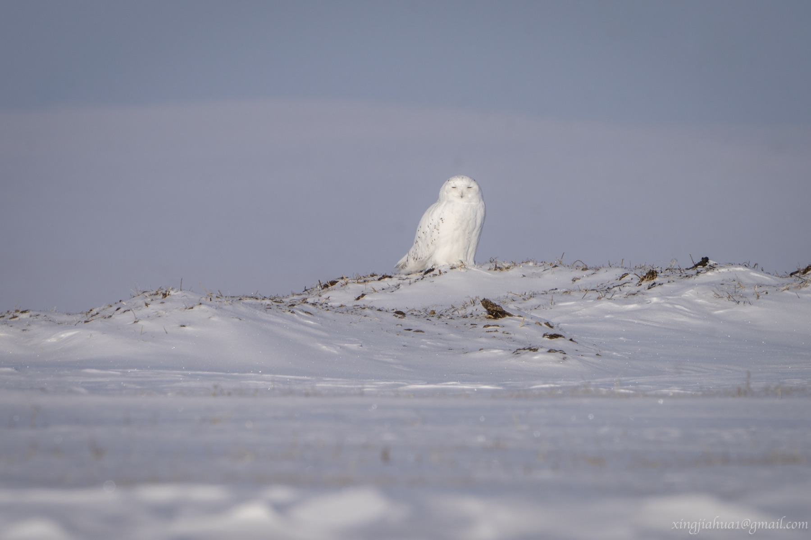

# Jiahua's Birding

My personal birding journal — trip reports, photographs, and a map of the places the birds have taken me.

Live site: **https://xingjh-1998.github.io**

## How the site is put together

- `index.md` — homepage. The hero photo, kicker, subtitle, caption and the "at a glance" facts are all set in its front matter.
- `_posts/` — field notes. Add one Markdown file per trip (`YYYY-MM-DD-title.md`).
- `blog.md` — the journal index, listing every post.
- `about.md` — about page, including the portrait and fact list (front matter).
- `_layouts/` — custom layouts (`home`, `blog`, `post`, `about`, `page`, `default`).
- `_includes/` — shared header and footer.
- `assets/css/site.css` — the whole design system (no Sass build step).
- `assets/js/site.js` — header state, scroll reveals, photo lightbox.
- `images/` — photographs, plus `-sm` variants for smaller screens.

The site uses Jekyll 3.9 (the GitHub Pages build) with `jekyll-feed`, `jekyll-seo-tag` and `jekyll-sitemap`. There is no theme gem — all layouts and styles are local.

## Writing a trip report

Create `_posts/YYYY-MM-DD-slug.md`:

```yaml
---
layout: post
title: "Hailar, Inner Mongolia"
date: 2026-02-03
categories: [birding, trip]
kicker: "Birding · Inner Mongolia"
location: "Hailar & Urqihan, Inner Mongolia"
cover: /images/Hailar-post/sundog.jpg
cover_sm: /images/Hailar-post/sundog-sm.jpg
cover_alt: "A sun dog over the winter steppe"
cover_caption: "Winter light on the Hailar steppe, January 2026."
excerpt: "One or two sentences for the journal cards."
trip:
  - label: Where
    value: "Hailar & Urqihan"
  - label: When
    value: "January 2026"
  - label: Targets
    value: "Snowy Owl · Snow Bunting"
  - label: New lifers
    value: "6"
---
```

Then write the piece in Markdown. Wrap photos in a figure so they get a caption and open in the lightbox:

```html
<figure>
  
  <figcaption>The wild male — sleepy, distant, and worth the slow approach.</figcaption>
</figure>
```

## Photos

Keep the long edge of full-size images around 1800–2400 px and save as JPEG at quality ~80. For each photo add a `-sm.jpg` variant with a 900 px long edge for phones and slow connections. On macOS:

```sh
sips -Z 1800 -s format jpeg -s formatOptions 80 photo.jpg --out images/post/photo.jpg
sips -Z 900  -s format jpeg -s formatOptions 78 photo.jpg --out images/post/photo-sm.jpg
```

## Local preview

GitHub Pages builds the site automatically when you push to `main`; nothing needs to be committed from a local build. To preview locally (Ruby 3.x recommended), install Jekyll and run:

```sh
gem install jekyll -v 3.9.5
gem install jekyll-feed jekyll-seo-tag jekyll-sitemap
jekyll serve
```

Then open http://localhost:4000.

## Deployment

Commit the changes and push to `main`. GitHub Pages rebuilds the site in a minute or two.
