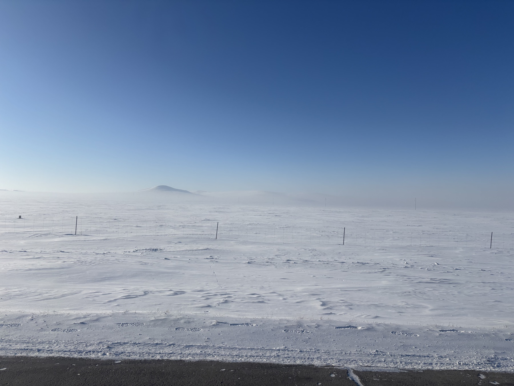
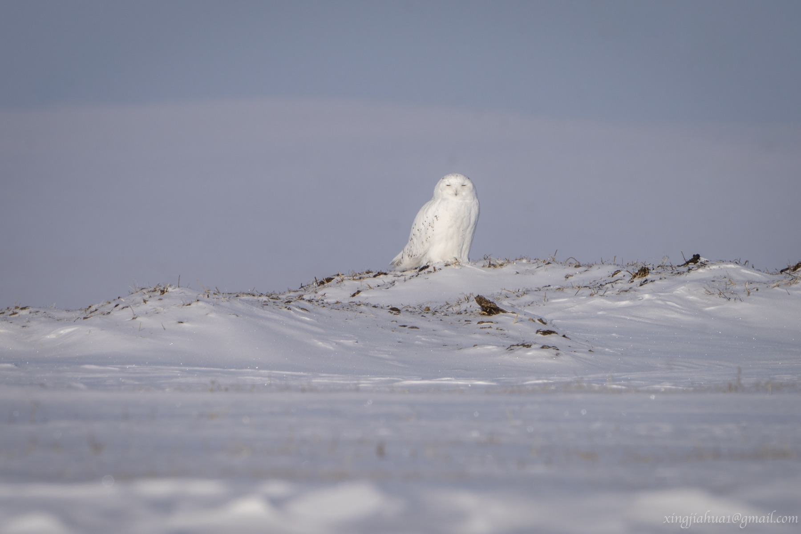
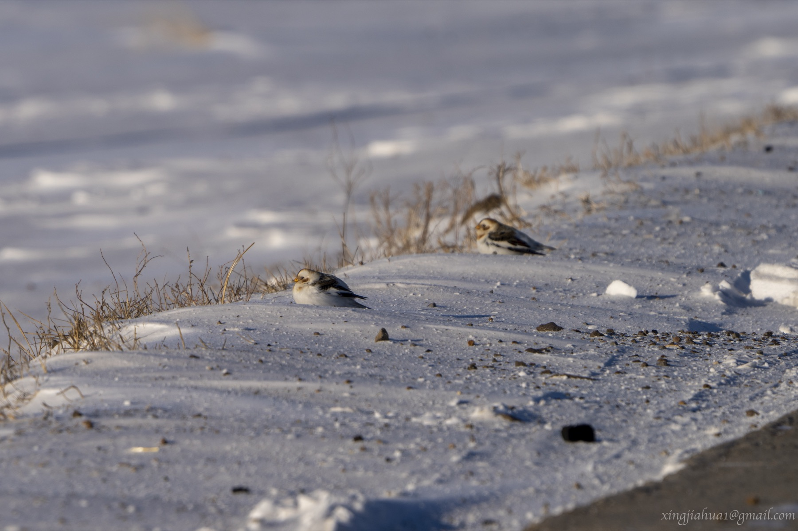

Inner Mongolia has long been my winter birding target, drawn by its unique winter birds and resident owls. For many reasons, it wasn't until January 2026 that I could spare the time and money for the trip — and it gave me six easy (kind of) lifers, all long-wanted northern birds, pushing my China list past 1,150.

Any birding trip in this area means contacting a local guide, Mr. Zhang — long a sharp local hunter, now a brilliant local birding guide. He arranges the logistics, guiding and transport from Hailar, so all we had to do was buy return flights; he handled everything else.

A typical winter trip runs eight days, covering Hailar and the country in and around Urqihan village. It begins on the steppe near Hailar, chasing the most famous wintering star: Snowy Owl. Even non-birders know this species, thanks to Hedwig in the Harry Potter films.

<figure>
  
  <figcaption>Snowy Owl country: flat, wind-scoured and impossibly wide.</figcaption>
</figure>

Many Snowy Owls winter in the open habitat near Hailar. Some local people feed them domestic hamsters — ten a day over a continuous period — to make certain individuals “reliable” for photographers and birders alike. I'd bet 90% of the close-up and in-flight photos of this species come from that kind of work. Luckily, we had a genuinely wild pair. The male gave a good view in a nice, sleepy roost, and we approached slowly to about 100 metres; we didn't have the luck of a close female, which flew over the steppe around a kilometre away. Still a great view to me!

<figure>
  
  <figcaption>The wild male — sleepy, distant, and worth every metre of the slow approach.</figcaption>
</figure>

Snow Bunting is the other target here, and usually we picked them up on the way to the owl. They're nice, cute, apparently legless birds that move over the ground like agile snails. Beyond these two targets, there isn't much else around: Mongolian Lark and Horned Lark can be found near any kind of pasture; House Sparrow sometimes appears among the Tree Sparrow flocks near buildings; and Carrion Crow and Magpie are the default corvids here.

<figure>
  
  <figcaption>Snow Buntings, feeding where the wind has cleared the snow.</figcaption>
</figure>
